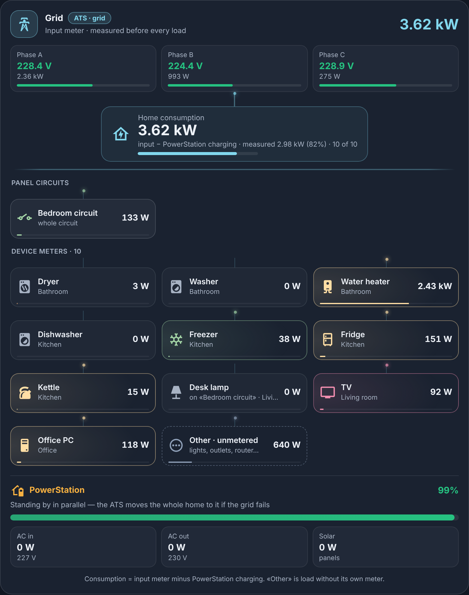
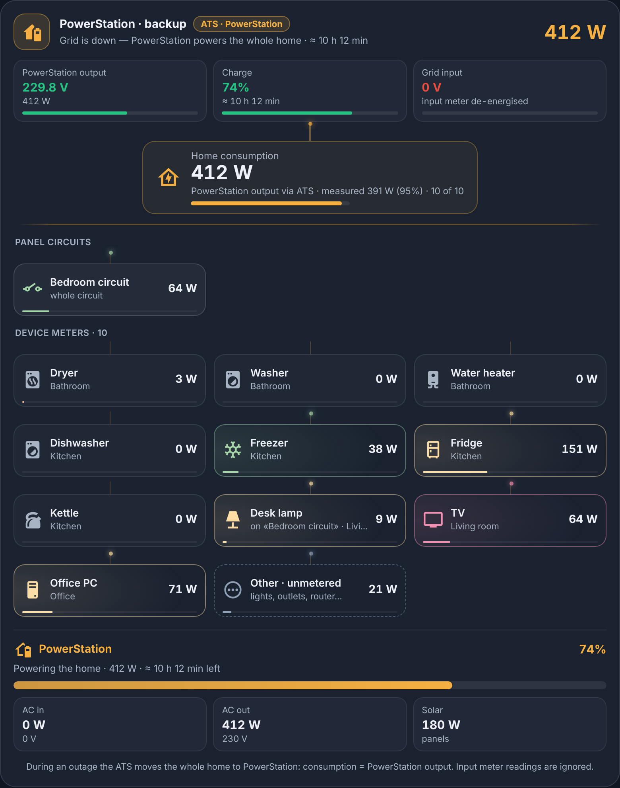
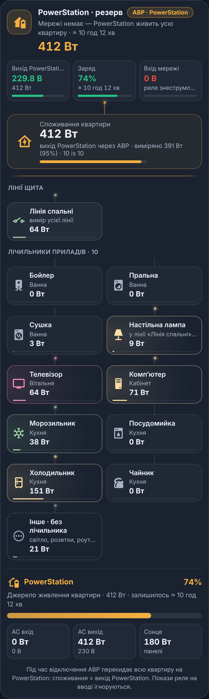

# Home Energy Flow Card

[](https://hacs.xyz/docs/faq/custom_repositories)
[](https://github.com/kdimiter/home-energy-flow-card/releases)
[](https://github.com/kdimiter/home-energy-flow-card/actions/workflows/validate.yml)

A Lovelace card for homes with an **input meter** (a voltage/energy relay installed before every load) and a **battery / power station / inverter** that takes over the whole home through an **ATS** when the grid goes down.

The card always knows *where the power comes from right now*, shows every power meter you have — found automatically, no limit on the number — and computes the part of the load that no meter covers.

[Українською ↓](#українською)

| Grid | Outage — battery powers the home | Phone |
|---|---|---|
|  |  |  |

*Screenshots are rendered from demo data.*

## Features

- **Live source detection.** Grid ↔ battery is decided from the battery's own AC output, so the card switches the moment the ATS does — not minutes later when a de-energised input meter finally goes `unavailable`. Stale readings of a powered-down meter are ignored.
- **Correct home consumption in both modes.** On grid: *input meter − battery charging* (the battery charges behind the meter). On backup: *battery AC output*, with an optional fallback meter (e.g. a smart plug on the battery output) if the battery itself is offline.
- **Phases.** Up to three phases with voltage health colours (green 215–240 V, amber, red below 205 / above 245 V) and per-phase power.
- **Unlimited devices, auto-discovered.** Every `sensor` with `device_class: power` (W or kW) becomes a tile. Source devices, hidden and diagnostic entities are skipped. Add or hide devices manually when you need to.
- **Panel circuits.** A meter that measures a whole line (an RCBO with metering, a DIN-rail meter) is shown as a circuit; meters behind it can be nested so they are displayed but never counted twice.
- **“Other · unmetered”** — what the meters don't explain, with a warning when the meters add up to more than the input.
- **Visual editor.** Configure everything in the UI — entities, phases, battery, auto/manual device selection, circuits, and a label, icon and colour per device. YAML works too.
- **English and Ukrainian**, picked from the user's Home Assistant language. Theme-aware, responsive (2/3/4 columns), keyboard accessible, respects *reduced motion*, pauses animation when off-screen.

## Installation

### HACS (recommended)

[](https://my.home-assistant.io/redirect/hacs_repository/?owner=kdimiter&repository=home-energy-flow-card&category=plugin)

Or manually in HACS:

1. **HACS → ⋮ → Custom repositories**.
2. Repository: `https://github.com/kdimiter/home-energy-flow-card`, type **Dashboard**, then **Add**.
3. Open **Home Energy Flow Card** → **Download**.
4. Reload the browser (in the Companion app use **Reset frontend cache** in the app settings).

HACS registers the dashboard resource for you.

### Manual

1. Download `home-energy-flow-card.js` from the [latest release](https://github.com/kdimiter/home-energy-flow-card/releases/latest) into `/config/www/`.
2. **Settings → Dashboards → ⋮ → Resources → Add resource**: URL `/local/home-energy-flow-card.js?v=2.1.0`, type **JavaScript module**.
3. Reload the browser. When you update the file later, bump `?v=` — Home Assistant serves `/local/` with a long browser cache.

## Configuration

### Visual editor

**Edit dashboard → Add card → Home Energy Flow**. The card picker pre-fills plausible entities; then adjust the sections:

| Section | What you set |
|---|---|
| General | Title, device order (area / power / name), thresholds |
| Grid input meter | Total input power, “online / grid present” binary sensor, label, up to 3 phases |
| Battery / inverter | AC output, AC input, state of charge (required); label, voltages, solar, status, remaining times, fallback output meter |
| Device meters | Auto-discovery on/off, add devices manually, hide devices, panel circuits with nested meters, label · icon · colour per device |

Manual-only selection: turn **Auto-discover** off and pick the devices under **Add devices manually**.

### YAML

```yaml
type: custom:home-energy-flow-card
grid:
  power: sensor.input_power                # total power at the input meter (W or kW)
  online: binary_sensor.input_meter        # on = meter reachable / grid present
  name: Grid                               # optional label
  phases:                                  # optional, up to 3
    - {name: A, voltage: sensor.input_voltage_a, power: sensor.input_power_a}
    - {name: B, voltage: sensor.input_voltage_b, power: sensor.input_power_b}
    - {name: C, voltage: sensor.input_voltage_c, power: sensor.input_power_c}
battery:
  name: PowerStation                       # optional label
  ac_out: sensor.station_ac_out_power      # required: feeds the home during an outage
  ac_in: sensor.station_ac_in_power        # required: charging from the grid
  soc: sensor.station_battery_level        # required: %
  ac_in_volts: sensor.station_ac_in_voltage      # optional, improves source detection
  ac_out_volts: sensor.station_ac_out_voltage    # optional
  solar_in: sensor.station_solar_power           # optional
  status: sensor.station_status                  # optional, state "online" = reachable
  discharge_time: sensor.station_discharge_remaining   # optional, minutes
  charge_time: sensor.station_charge_remaining         # optional, minutes
  backup_meter: sensor.station_output_plug_power       # optional fallback for ac_out
discover: true                  # auto-discover every power sensor (default true)
include: [sensor.my_template_power]       # add sensors manually (e.g. without device_class)
exclude: [sensor.kitchen_total_power]     # hide sensors (e.g. sums of other meters)
circuits:
  - entity: sensor.bedroom_line_power
    name: Bedroom circuit
    children: [sensor.desk_lamp_power]    # meters behind this circuit: shown, not counted twice
devices:                                  # optional overrides per device
  sensor.water_heater_power: {name: Water heater, icon: mdi:water-boiler, color: '#ff8a65'}
sort: area                      # area | power | name
backup_threshold: 30            # W on battery output that means "backup is active"
active_threshold: 5             # W above which a tile is highlighted and animated
```

| Option | Required | Default | Description |
|---|---|---|---|
| `grid.power` | ✓ | — | Total power at the input meter |
| `grid.online` | ✓ | — | Binary sensor: meter reachable / grid present |
| `grid.phases[]` | | — | `name`, `voltage`, `power` per phase (max 3) |
| `battery.ac_out` / `ac_in` / `soc` | ✓ | — | Battery output, input and state of charge |
| `battery.*` other keys | | — | See the example above |
| `discover` | | `true` | Auto-discover power sensors |
| `include` / `exclude` | | `[]` | Manual add / hide |
| `circuits[]` | | `[]` | `entity`, `name`, `icon`, `color`, `children` |
| `devices` | | `{}` | `name`, `icon`, `color` (`#rrggbb`) per entity |
| `sort` | | `area` | `area`, `power` or `name` |
| `backup_threshold` | | `30` | W |
| `active_threshold` | | `5` | W |
| `title` | | — | Card title |

`ecoflow:` is accepted as an alias of `battery:` (its label then defaults to “EcoFlow”), and v1 configs (`grid.entity`, `grid.outage_entity`, `appliances`) still load.

## How the source is decided

| Mode | Condition | Home consumption |
|---|---|---|
| Grid | battery AC output ≤ `backup_threshold` and `grid.online` is `on` | `grid.power − battery.ac_in` |
| Backup | battery AC output > `backup_threshold`, or AC input voltage < 100 V | `battery.ac_out` (or `backup_meter`) |
| Grid, input meter offline | `grid.online` is `off` but the battery still sees ≥ 100 V on its input | not measured — a network blip, not an outage |

Typical wiring this was built for: grid → input meter → panel → loads; the battery charges from the panel and its AC output goes to the backup input of the ATS. During an outage the ATS moves the whole home to the battery and the input meter is de-energised.

## Privacy & security

The card is a single static JavaScript file. It **only reads** the `hass` object Home Assistant already gives every card (`states`, `entities`, `devices`, `areas`, language). It makes **no network requests**, calls **no services**, stores nothing (no cookies, `localStorage` or `IndexedDB`), has no telemetry and no third-party code. Entity IDs live only in your dashboard config, never in the card. Every text is set with `textContent`, so names coming from entities cannot inject HTML. Clicking a tile only opens Home Assistant's own *more-info* dialog.

## Troubleshooting

- **“Configuration error” right after an update** — the browser still runs the old file. Hard-reload (Ctrl+Shift+R), or reset the frontend cache in the Companion app.
- **A device is missing** — the sensor needs `device_class: power` and unit `W`/`kW`. Otherwise add it under `include`.
- **“Meters exceed input”** — a meter sits behind another one (add it to that circuit's `children`) or meters update at different moments.
- **Card stays on “Grid” during an outage** — check that `battery.ac_out` really reports the output power, or lower `backup_threshold`.

## Development

```bash
npm test                     # unit tests (node:test, no dependencies)
cd demo && npm i && cd ..    # icons for the screenshot harness
python3 demo/shoot.py        # renders images/*.png from demo data (Playwright + Chromium)
```

## License

[MIT](LICENSE)

---

## Українською

Картка для дому з **реле напруги / лічильником на вводі** (перед усіма споживачами) і **зарядною станцією / ДБЖ / інвертором**, на який **АВР** перекидає всю квартиру при відключенні світла.

**Що вміє:**

- **Джерело живлення в реальному часі.** «Мережа» чи «резерв» визначається за виходом самої батареї, тож картка перемикається одразу разом з АВР. Застарілі покази знеструмленого реле ігноруються.
- **Правильне споживання в обох режимах.**
  - На мережі: *ввід − заряд батареї*.
  - На резерві: *вихід батареї*; якщо сама батарея офлайн — запасний лічильник, наприклад розетка на виході.
- **До трьох фаз** з контролем напруги.
- **Прилади без обмеження кількості.** Картка автоматично знаходить усі сенсори з `device_class: power` (Вт/кВт). Прилади можна також додавати чи ховати вручну.
- **Лінії щита з вкладеними лічильниками**: вкладені показуються, але не рахуються двічі.
- **Плитка «Інше · без лічильника»** — споживання, яке не покриває жоден лічильник.
- **Візуальний редактор.** Сутності, фази, батарея, автоматичний чи ручний вибір приладів, лінії, а також назва, іконка й колір кожного приладу. YAML теж працює.
- **Мова інтерфейсу** — українська або англійська, за мовою профілю Home Assistant.

**Встановлення через HACS:**

1. **HACS → ⋮ → Custom repositories**.
2. Додайте `https://github.com/kdimiter/home-energy-flow-card`, тип **Dashboard**.
3. Відкрийте картку → **Download**.
4. Оновіть сторінку з очищенням кешу (Ctrl+Shift+R).

**Налаштування:** **Редагувати дашборд → Додати картку → Home Energy Flow**. Приклад YAML і таблиця параметрів — вище. Ключ `ecoflow:` працює як синонім `battery:`.

**Приватність:** картка лише читає дані, які Home Assistant і так передає кожній картці. Вона не робить мережевих запитів, нічого не зберігає, не викликає сервісів і не має телеметрії. Ваші `entity_id` зберігаються тільки у вашому конфігу дашборду.
